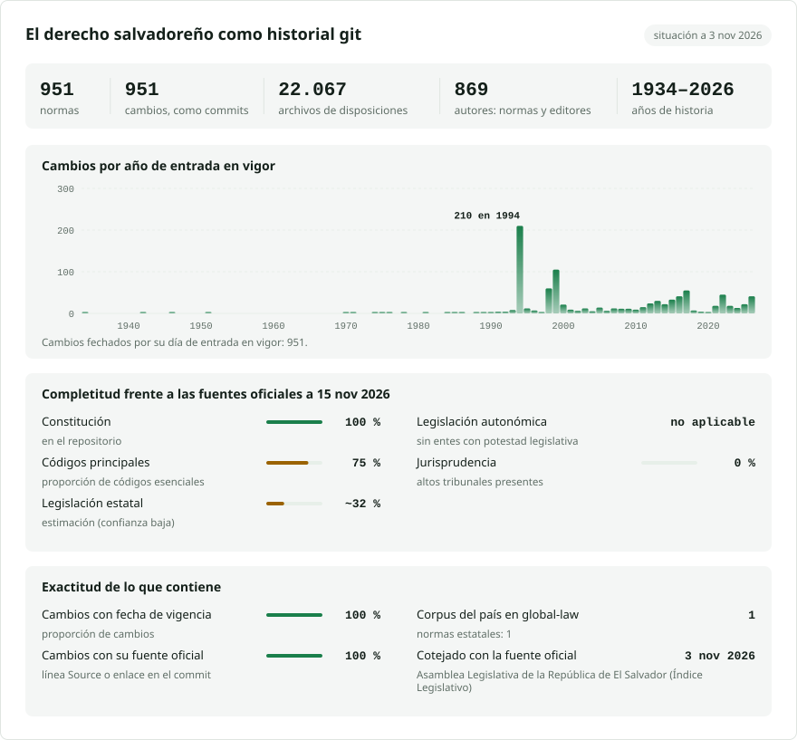

# El Salvador: historia del derecho en git

**Español** · [English](README.en.md)

<picture>
<source media="(prefers-color-scheme: dark)" srcset="data/es/effort-dark.svg">

</picture>

El derecho nacional de El Salvador como historia de git: un archivo por artículo, un commit por versión el día en que entró en vigencia, y la ley que está detrás de cada versión como autor del commit. `git blame` indica la ley que está detrás de cada artículo; `git log` enumera todos los cambios de un artículo; al elegir una fecha se obtiene el texto vigente ese día, hasta donde alcanza el registro.

Forma parte de [lexifina/global-law](https://github.com/lexifina/global-law), una única historia de git para el derecho de todos los países: este es el derecho nacional de El Salvador, que global-law lee en `el-salvador/national/acts/`.

**Qué contiene ahora:** la Constitución de 1983, cinco códigos (el Código Civil, el Código de Comercio, el Código de Trabajo, el Código Penal y el Código Procesal Penal) y 945 decretos de la Asamblea Legislativa (leyes, tratados ratificados y otros decretos legislativos), cada uno en una versión: el texto actual con sus reformas incorporadas. [`data/versions.json`](data/versions.json) enumera cada norma con su versión; la carpeta de cada norma tiene un `README.md` que enumera sus disposiciones.

Cada norma es una carpeta: `constitution/constitucion/`, `code/<code>/` (`code/codigo-de-trabajo/` es el Código de Trabajo, Decreto Legislativo n.º 15 de 1972) y `decreto/<year>/<number>/` (`decreto/1940/0017/` es el Decreto N° 17 de 1940, la Ley de Asuetos, Vacaciones y Licencias de los Empleados Públicos; un segundo decreto con el mismo año y número toma el identificador de vista del Índice, `decreto/2015/0961-v3138/`). Dentro de ella, `art-177.md` es el Art. 177 y `art-010-bis.md` el Art. 10 bis; el `preambulo.md` de un decreto contiene el texto anterior al Art. 1 y `firma.md` el cierre y las firmas. [`data/paths.json`](data/paths.json) relaciona el identificador de cada norma con su carpeta.

El texto está en español, tal como lo publica la Asamblea Legislativa. Este registro no incluye una traducción al inglés.

## Preguntas como comandos de git

| Pregunta | Comando |
| --- | --- |
| Todos los cambios del Art. 177 (vacaciones anuales) del Código de Trabajo | `git log -p --follow --word-diff -- code/codigo-de-trabajo/art-177.md` |
| ¿Qué norma escribió cada línea del Art. 177? | `git blame code/codigo-de-trabajo/art-177.md` |
| Todas las versiones del Código de Trabajo, con el día en que entró en vigencia cada una | `git log --format="%h %(trailers:key=In-force,valueonly,separator=) %an" --grep="^Act: CT$"` |
| El Art. 177 vigente al 1 de noviembre de 2026 | `python tools/on.py 2026-11-01 codigo-de-trabajo 177` |

**Fuera de git**, también alojamos este registro de forma pública y gratuita:

- **[Preguntar a Claude sobre el derecho salvadoreño](https://global-law.lexifina.com/v1/try_claude?country=el-salvador)**: abre Claude con una primera pregunta preparada.
- **[Preguntar a ChatGPT](https://global-law.lexifina.com/v1/try_chatgpt?country=el-salvador)**: la misma pregunta en ChatGPT.
- **[Buscar en el derecho salvadoreño en nuestro sitio](https://lexifina.com/law?country=el-salvador&q=vacaciones)**: una búsqueda de "vacaciones", con el texto de cada disposición y sus versiones, sin necesidad de cuenta.
- **[API REST para desarrolladores](https://global-law.lexifina.com/v1/search_law?query=vacaciones&jurisdiction=el-salvador)**: la misma búsqueda en JSON, sin clave. Consulte la [documentación aquí](https://lexifina.com/api/global-law).

Ambos asistentes leen el registro a través del conector gratuito Global law (MCP, `https://global-law.lexifina.com/mcp`); la primera vez, el chat le da el enlace para agregarlo. Pregunte en español o en inglés.

**Alójelo usted mismo fácilmente.** Solo hacen falta git y Python, y las herramientas se ejecutan en su equipo:

```sh
git clone --depth 1 https://github.com/lexifina/global-law && cd global-law
python3 tools/countries.py add el-salvador/national/acts
python3 tools/law.py show 2026-11-01 el-salvador/national/acts/code/codigo-de-trabajo/art-177.md
```

Abierto en Claude Code, Cursor, VS Code o Codex, el clon también inicia un servidor MCP local con las mismas herramientas ([MCP.md](https://github.com/lexifina/global-law/blob/main/MCP.md)).

## Fechas

Cada commit está fechado a las doce del mediodía, hora de America/El_Salvador, del día en que la versión entró en vigencia, y lleva ese día en su trailer `In-force:`:

- para la Constitución y los códigos, el día del Diario Oficial de la última reforma que enumera la fuente (la Constitución, el 7 de mayo de 2026; el Código Penal, el 27 de marzo de 2026; el Código Civil, el 26 de abril de 2022; el Código de Comercio, el 11 de abril de 2024), o el día en que esa reforma entró en vigencia, según la propia reforma (el Código de Trabajo, el 24 de septiembre de 2026; el Código Procesal Penal, el 26 de abril de 2026);
- para un decreto sin reformas enumeradas, el día que da su propio artículo de vigencia o, en su defecto, ocho días después de su publicación en el Diario Oficial (art. 140 de la Constitución); para un decreto reformado, ocho días después de la publicación en el Diario Oficial de la última reforma enumerada; cuando no se pudo leer la lista (17 decretos), el día en que se descargó, el 3 de noviembre de 2026;
- git no puede almacenar fechas anteriores a 1970, por lo que los 7 decretos vigentes desde antes (de 1934 a 1951) están fechados a partir del 1970-01-01, con un segundo de diferencia entre sí, y llevan el día real en `In-force:`. Para consultar una fecha, use `tools/on.py`, no `git log --before`.

Un decreto sin reformas se atribuye a sí mismo (`D. L. N° 149 de 1934`) y uno reformado a su última reforma (`D. L. N° 674 de 2026`), por todo su texto. La Constitución, los códigos y los 17 decretos cuya lista de reformas no se pudo leer son la "versión más antigua disponible", atribuida a quien la publica, el Índice Legislativo de la Asamblea Legislativa.

## Cómo se verifica

- Todos los textos se leen de la capa de texto de los PDF nativos digitales de la Asamblea, sin OCR. En un decreto, cada palabra anterior al bloque del Diario Oficial está en un archivo, en orden, salvo los encabezados de página, las marcas de reforma "(n)" y las notas de los editores.
- Se excluye todo decreto cuyos artículos no estén numerados 1, 2, 3 y así sucesivamente, cada uno una sola vez, y también los decretos transitorios, que pueden haber caducado.
- `tools/build.py` escribe la historia a partir de un único archivo de corpus, y el mismo corpus produce siempre los mismos hashes de commit; `tools/check_repo.py` vuelve a leer desde git cada versión y la compara con el corpus, y verifica que `main` no tenga commits de fusión (merge) ni nada fechado en el futuro. [`REPRODUCE.md`](REPRODUCE.md) todavía no registra ninguna ejecución de esa verificación ni una segunda compilación.
- [vulnerabilities/](vulnerabilities/): posibles errores de técnica normativa en el derecho salvadoreño, hallados por los detectores de global-law y comprobados a mano.

## Qué no muestra

- **Las redacciones anteriores.** Cada norma es un único texto, tal como la Asamblea lo publica hoy: no está aquí cómo se leía el Código de Trabajo antes de su reforma de 2026, ni la Constitución tal como se adoptó en 1983. Los pasajes que una reforma cambió aparecen en mayúsculas en la fuente y se conservan así.
- **Qué reforma cambió qué artículo.** Todo el texto de un decreto reformado se atribuye a su última reforma, y los códigos y la Constitución, a quien los publica.
- **Encabezados y notas.** Los encabezados de Libro, Título y Capítulo entre los artículos, las notas de reforma y los encabezados de página no están en los archivos; los Arts. 15 y 456 del Código de Comercio no figuran en el texto de la fuente.
- **La mayoría de los decretos del Índice Legislativo**, entre ellos los excluidos arriba; tampoco los decretos ejecutivos y reglamentos, las ordenanzas municipales ni la jurisprudencia.

## Fuentes

| Fuente | Tipo | Versiones anteriores | Notas |
| --- | --- | --- | --- |
| [Asamblea Legislativa, Índice Legislativo](https://www.asamblea.gob.sv/leyes-y-decretos/decretos-por-anios) | Índice oficial de decretos legislativos | no: el texto vigente, con su lista de reformas | La Constitución, los cinco códigos y los 945 decretos, a partir de sus PDF; la publicación en el Diario Oficial de cada decreto y de sus reformas |

## Licencia

Véase [`LICENSE`](LICENSE). El artículo 50 de la Ley de Propiedad Intelectual (Decreto Legislativo n.º 66 de 2024) permite publicar las leyes, por separado o en colecciones, con fidelidad al texto oficial y sin autorización del Gobierno. La organización, las tablas, los mensajes de commit y las herramientas son de Lexifina, con licencia Creative Commons Atribución 4.0 Internacional.

Ningún modelo de IA escribió, tradujo ni corrigió texto normativo, y ninguno se ejecuta durante la compilación; los scripts los escribió Claude Code con Claude Opus 5.5 (véase [`REPRODUCE.md`](REPRODUCE.md)).

Esta es una traducción de la versión inglesa ([README.en.md](README.en.md)); si difieren, prevalece la versión inglesa.

## Visualizaciones

- [visualisations/](visualisations/): gráficos hechos a partir de este repositorio. Aún no se han hecho.

## Más información

Del repositorio [lexifina/global-law](https://github.com/lexifina/global-law) (páginas en inglés):

- [FEATURES.md](https://github.com/lexifina/global-law/blob/main/FEATURES.md): todas las funciones y lo que cada corpus debe admitir (`git blame`, `law.py`, herramientas MCP)
- [FAQ.md](https://github.com/lexifina/global-law/blob/main/FAQ.md): preguntas y respuestas · [CONTRIBUTING.md](https://github.com/lexifina/global-law/blob/main/CONTRIBUTING.md): proponer cambios · [MCP.md](https://github.com/lexifina/global-law/blob/main/MCP.md): servidor MCP · [REPRODUCE.md](https://github.com/lexifina/global-law/blob/main/REPRODUCE.md): cómo se ha construido · [CHANGELOG.md](https://github.com/lexifina/global-law/blob/main/CHANGELOG.md)
- [FRESHNESS.md](https://github.com/lexifina/global-law/blob/main/FRESHNESS.md): lo actualizado que está cada corpus · [Supervisión](https://github.com/lexifina/global-law/tree/main/monitoring): si las actualizaciones funcionan · [WATCHING.md](https://github.com/lexifina/global-law/blob/main/WATCHING.md): cómo se vigila cada fuente oficial para detectar cambios
- [performance/](https://github.com/lexifina/global-law/tree/main/performance): la rapidez de las herramientas, medida
- [visualisations/](https://github.com/lexifina/global-law/tree/main/visualisations): gráficos y conexiones a través del derecho de todo el mundo
- [Vulnerabilidades](https://github.com/lexifina/global-law/tree/main/vulnerabilities): errores en las normas tal como se publicaron
