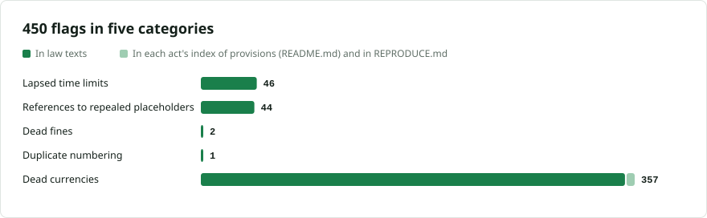

# Vulnerabilities in Salvadoran law

[Español](README.md) · **English**

<picture>
<source media="(prefers-color-scheme: dark)" srcset="img/flags-by-category-dark.svg">

</picture>

The vulnerability detectors from [lexifina/global-law](https://github.com/lexifina/global-law/tree/main/vulnerabilities) look for mechanical mistakes in legislation: a rule applying "until" a date that has passed, a time limit extended only after it had run out, an amount changed in one place but not in another, a penalty for breaching an article that has been repealed, an article citing another that no longer has any content. global-law's published list (9 November 2026) did not include El Salvador, so this is a run over this repository only, as it stood at commit [`d303182`](https://github.com/lexifina/el-salvador-law/commit/d30318217ffcb29aaaa4560950e33bc3f8b611c9) on 16 November 2026.

**In short:** the detectors raised 450 flags, 357 of them amounts in colones or German marks. A language model reviewed the 40 strongest, all lapsed time limits, arguing each one for and against; none survived. Checked by hand in this repository, four of them, in three extension decrees, point to real gaps in Salvadoran law: extensions that took effect after the time limit they extended had run out, with no retroactive wording. The capacity granted to former combatants of the Armed Forces and of the FMLN aged sixteen to bind themselves under the land transfer programme and the housing programme (Legislative Decrees No. 403 of 1992 and No. 605 of 1993) ran until 30 June 1994; Legislative Decrees No. 53 and No. 54 of 1994, passed that same day, extended it to 30 September, but took effect only on publication, on 16 and 17 August 1994 (3 flags). The time limit in Article 107 of the Environment Act for filing an environmental assessment ran out on 13 May 2000; Legislative Decree No. 891 of 2000 extended it from its publication, on 16 May. By contrast, Legislative Decree No. 771 of 1994, which had extended the same Decree No. 403 late, made its effects run from the day after the lapse. Of the other 36, 17 are lawful (extensions made in time or made retroactive), 16 are spent rules (transitional provisions of the Constitution, the Commercial Code and the Organic Act of the Central Reserve Bank, among others) and 3 are terms of loan contracts approved by decree and dates in a recital. The model does not review the other categories; reading them turned up 31 references to repealed articles of the same act, among them the serious offence in Article 78(e) of the Medicines Act, which still penalises "breach of Article 5", an article that now reads only "DEROGADO". Later, this will be formalised in Lean, similar to our work on [the US tax code](https://lexifina.com/blog/formalizing-the-us-tax-code) and [US case law](https://lexifina.com/blog/formalizing-all-us-case-law-in-lean).

A flag is a prompt to look, not legal advice, and nothing here has been tested in court.

## Flags by category

| Category | What it looks for | Flags | In law texts | Reviewed | Survived review |
| --- | --- | ---: | ---: | ---: | ---: |
| Lapsed time limits | Text still applying a rule "until" a date that has passed | 46 | 46 | 40 | 0 |
| References to repealed placeholders | An article citing another that now reads only "DEROGADO" | 44 | 44 | 0 | 0 |
| Dead fines | A penalty for breaching an article that has been repealed | 2 | 2 | 0 | 0 |
| Duplicate numbering | Two units with the same number in one act | 1 | 1 | 0 | 0 |
| Dead currencies | Amounts in currencies no longer in circulation | 357 | 349 | 0 | 0 |

"In law texts" counts every file of an act: the Constitution, the five codes and the Legislative Assembly's 945 decrees, with their preambles and signature blocks. The other flags are in each decree's `README.md`, which repeats its title (four titles with amounts in colones), and in `REPRODUCE.md`. Every act is here in one version, the text in force as the Assembly publishes it, so there are no changes to compare: the search for repeal gaps, same-day conflicts, retroactive dates, empty periods, stale amounts, references to deleted provisions and publisher notes found nothing. The search for lapsed time limits now also reads dates written in words, as Salvadoran decrees write them ("hasta el treinta y uno de diciembre de dos mil catorce", "hasta el día treinta de abril de mil novecientos ochenta y cinco"): 32 flags became 46, and the 14 new ones are every such phrase with "hasta" in the repository. It still leaves out time limits with "a más tardar" (no later than; 11, in figures or in words, all past) or "antes del" (before) followed by a date. The search for dead currencies now reads the colón ("¢2,000.00", "50 colones"): the Monetary Integration Act (Legislative Decree No. 201 of 2000), in force from 1 January 2001, fixed the rate at 8.75 colones to the dollar, and the colón, which is still legal tender, no longer circulates. The 5 flags, all in German marks, became 357. The colón is read for El Salvador only: Costa Rica's is still in use.

*Edge cases: the 40 flags the model reviewed, each checked by hand and grouped by what it turned out to be, and what the other flags are, in [EDGE-CASES.en.md](EDGE-CASES.en.md).*

## Problems found in this repository

- **In-force dates eight days late:** the README says a decree without amendments is dated by its own commencement article or, failing that, eight days after its publication in the Diario Oficial. Of the decrees whose commencement article makes them apply from publication, the 229 that say "desde el día de su publicación" carry that day in `In-force:`, but at least 54 that say "el día de su publicación" (33) or "a partir del día de su publicación" (21) carry the day of publication plus eight days. Among them are Legislative Decree No. 54 of 1994, published on 17 August and dated 25 August 1994 ([the commit](https://github.com/lexifina/el-salvador-law/commit/6bc79bd7fe0cb9b7fe72dad2748a06301cbb2b9d)), No. 681 of 1999 (published on 31 August, dated 8 September) and No. 891 of 2000 (published on 16 May, dated 24 May). A reader of the text in force on one of those dates does not see these decrees for their first eight days.
- **The sign "º" read as "1":** in many acts the text has "1" where "º" or "°" belongs, probably from the way the PDFs' text layer encodes that sign. "N1" followed by a number, for "N°", appears 223 times in 91 acts (for example "Decreto Legislativo N1 320" in [Decree No. 43 of 1974](https://github.com/lexifina/el-salvador-law/blob/d30318217ffcb29aaaa4560950e33bc3f8b611c9/decreto/1974/0043/art-001.md)); in the codes, "inciso", "número" or "ordinal" is followed 38 times by a figure from 11 to 91 ending in 1, such as "artículo 1235, inciso 31" in [Article 1263 of the Civil Code](https://github.com/lexifina/el-salvador-law/blob/d30318217ffcb29aaaa4560950e33bc3f8b611c9/code/codigo-civil/art-1263.md), where Article 1235 has four paragraphs. Three references to repealed placeholders come from this reading.

## Files

| File | What it holds |
| --- | --- |
| [data/flags.csv](data/flags.csv) | Every flag, one row per provision and issue |
| [data/reviewed.csv](data/reviewed.csv) | The 40 flags the model reviewed, with its verdict and reason |
| [data/by_category.csv](data/by_category.csv) | The counts in the table above |
| [tools/](tools/) | The scripts that made this run |

Columns: `category` and `category_es` (the category in English and Spanish), `detector`, `kind` (`law` or `other`), `path` (the file in this repository), `date` (the date the flag turns on), `reference` (the act or line involved), `summary`, `score` (the detector's ranking, 0 to 1), `review` (`artefact`, `lawful` or `candidate_defect`), `survives_rebuttal`, `review_note` (the model's reason, in English), `url` (the provision at the commit that was read).

## How it was made

- **Detectors:** global-law's [vulnerabilities/scripts](https://github.com/lexifina/global-law/tree/main/vulnerabilities/scripts), run on this repository at commit `d303182`. The history table the detectors read was built from this repository's own commits (the act that made each change, its `In-force` date and its `Kind`; documentation is left out). The detectors carry the fixes global-law's scripts received in the runs on other country repositories, and two for El Salvador: the dates in words and the colón, above.
- **Model review:** gpt-5.4-mini, the 40 strongest flags per category, and for lapsed time limits also the 40 strongest in law texts; one pass says whether a flag is real, a second argues that it is not. As every flag is in a law text, both reviews read the same 40 lapsed time limits, and the second is kept: in the first, 3 survived; in the second, 1 was judged a possible defect and dismissed by the arguing-against pass. There were no empty periods to review. The model does not review references to repealed placeholders, dead fines, duplicate numbering or dead currencies. global-law's own list used a different model.
- **Hand check:** each of the 40 reviewed flags was read in this repository's texts, and for the extension decrees the day the extended time limit ran out, as the decree itself states it, was compared with the decree's commencement article and its day of publication (`Published:` in its commit). The other 6 lapsed time limits, the 44 references to repealed placeholders, the 2 dead fines, the duplicate number and, by the words matched, the dead currencies were read too.

To report a correction, open an issue with the provision and an official source.

## Licence

The lists and notes are Lexifina's and, like this repository's arrangement, tables and tools, are licensed under Creative Commons Attribution 4.0 International. Quoted law text is as the Legislative Assembly publishes it in its Índice Legislativo; Article 50 of the Intellectual Property Act (Legislative Decree No. 66 of 2024) allows laws to be published, singly or in collections, faithful to the official text and without the Government's authorisation. See [LICENSE](../LICENSE).
