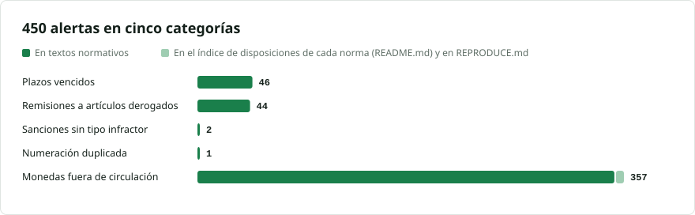

# Vulnerabilidades en el derecho salvadoreño

**Español** · [English](README.en.md)

<picture>
<source media="(prefers-color-scheme: dark)" srcset="img/flags-by-category-dark.es.svg">

</picture>

Los detectores de vulnerabilidades de [lexifina/global-law](https://github.com/lexifina/global-law/tree/main/vulnerabilities) buscan errores mecánicos en la legislación: una regla que sigue aplicándose «hasta» una fecha ya pasada, un plazo prorrogado cuando ya había vencido, un importe modificado en un lugar pero no en otro, una sanción por infringir un artículo derogado, un artículo que remite a otro que ya no tiene contenido. La lista que global-law publicó el 9 de noviembre de 2026 no incluía El Salvador, de modo que esta es una revisión de este repositorio solamente, en el estado del commit [`d303182`](https://github.com/lexifina/el-salvador-law/commit/d30318217ffcb29aaaa4560950e33bc3f8b611c9) de 16 de noviembre de 2026.

**En resumen:** los detectores generaron 450 alertas, 357 de ellas importes en colones o en marcos alemanes. Un modelo de lenguaje revisó las 40 más sólidas, todas plazos vencidos, con argumentos a favor y en contra de cada una; ninguna resistió. Comprobadas a mano en este repositorio, cuatro de ellas, en tres decretos de prórroga, señalan lagunas reales del derecho salvadoreño: prórrogas que entraron en vigencia cuando el plazo prorrogado ya había vencido, sin cláusula de retroactividad. La habilitación de edad que permitía a los excombatientes de la Fuerza Armada y del FMLN obligarse en el Programa de Transferencia de Tierras y en el programa de vivienda (Decretos Legislativos n.º 403 de 1992 y n.º 605 de 1993) regía hasta el 30 de junio de 1994; los Decretos Legislativos n.º 53 y n.º 54 de 1994, aprobados ese mismo día, la prorrogaron hasta el 30 de septiembre, pero rigieron solo desde su publicación, el 16 y el 17 de agosto de 1994 (3 alertas). El plazo del artículo 107 de la Ley del Medio Ambiente para presentar el diagnóstico ambiental vencía el 13 de mayo de 2000; el Decreto Legislativo n.º 891 de 2000 lo prorrogó desde su publicación, el 16 de mayo. En cambio, el Decreto Legislativo n.º 771 de 1994, que había prorrogado tarde el mismo Decreto n.º 403, retrotrajo sus efectos al día siguiente del vencimiento. De las otras 36, 17 son conformes a derecho (prórrogas a tiempo o con efectos retroactivos), 16 son reglas agotadas (disposiciones transitorias de la Constitución, del Código de Comercio y de la Ley Orgánica del Banco Central de Reserva, entre otras) y 3 son condiciones de contratos de préstamo aprobados por decreto y fechas de un considerando. El modelo no revisa las demás categorías; su lectura arrojó 31 remisiones a artículos derogados de la propia norma, entre ellas la infracción grave de la letra e) del artículo 78 de la Ley de Medicamentos, que sigue sancionando «el incumplimiento del Artículo 5», hoy reducido a «DEROGADO». Más adelante se formalizará en Lean, como nuestro trabajo sobre [el código tributario de EE. UU.](https://lexifina.com/blog/formalizing-the-us-tax-code) y [la jurisprudencia de EE. UU.](https://lexifina.com/blog/formalizing-all-us-case-law-in-lean).

Una alerta es una invitación a examinar el texto, no un asesoramiento jurídico, y nada de lo aquí expuesto se ha sometido a un tribunal.

## Alertas por categoría

| Categoría | Qué busca | Alertas | En textos normativos | Revisadas | Resistieron la revisión |
| --- | --- | ---: | ---: | ---: | ---: |
| Plazos vencidos | Un texto que sigue aplicando una regla «hasta» una fecha ya pasada | 46 | 46 | 40 | 0 |
| Remisiones a artículos derogados | Un artículo que remite a otro que solo dice «DEROGADO» | 44 | 44 | 0 | 0 |
| Sanciones sin tipo infractor | Una sanción por infringir un artículo derogado | 2 | 2 | 0 | 0 |
| Numeración duplicada | Dos divisiones con el mismo número en una norma | 1 | 1 | 0 | 0 |
| Monedas fuera de circulación | Importes en monedas que ya no circulan | 357 | 349 | 0 | 0 |

«En textos normativos» cuenta todos los archivos de una norma: la Constitución, los cinco códigos y los 945 decretos de la Asamblea Legislativa, con sus preámbulos y sus firmas. Las demás alertas están en el `README.md` de cada decreto, que repite su título (cuatro títulos con importes en colones), y en `REPRODUCE.md`. Cada norma figura aquí en una sola versión, el texto vigente que publica la Asamblea, de modo que no hay cambios que comparar: la búsqueda de lagunas tras la derogación, reformas del mismo día, vigencia anterior a la publicación, periodos de vacío normativo, montos no actualizados, remisiones a artículos inexistentes y notas del editor no halló nada. La búsqueda de plazos vencidos lee ahora también las fechas escritas en letras, como las escriben los decretos salvadoreños («hasta el treinta y uno de diciembre de dos mil catorce», «hasta el día treinta de abril de mil novecientos ochenta y cinco»): las 32 alertas pasaron a 46, y las 14 nuevas son todas las expresiones de ese tipo con «hasta» que hay en el repositorio. Sigue sin leer los plazos con «a más tardar» (11, en cifras o en letras, todos vencidos) o con «antes del» seguidos de una fecha. La búsqueda de monedas fuera de circulación lee ahora el colón («¢2,000.00», «50 colones»): la Ley de Integración Monetaria (Decreto Legislativo n.º 201 de 2000), vigente desde el 1 de enero de 2001, fijó el tipo de cambio en 8,75 colones por dólar, y el colón, que conserva curso legal, ya no circula. Las 5 alertas, todas en marcos alemanes, pasaron a 357. El colón se lee solo en El Salvador: el de Costa Rica sigue en uso.

*Casos límite: las 40 alertas que revisó el modelo, cada una comprobada a mano y agrupada según lo que resultó ser, y qué son las demás alertas, en [EDGE-CASES.md](EDGE-CASES.md).*

## Problemas detectados en este repositorio

- **Fechas de vigencia ocho días tardías:** según el README, un decreto sin reformas se fecha el día que da su propio artículo de vigencia o, en su defecto, ocho días después de su publicación en el Diario Oficial. De los decretos cuyo artículo de vigencia los hace regir desde la publicación, los 229 que dicen «desde el día de su publicación» llevan esa fecha en `In-force:`, pero al menos 54 que dicen «el día de su publicación» (33) o «a partir del día de su publicación» (21) llevan la fecha de publicación más ocho días. Entre ellos están el Decreto Legislativo n.º 54 de 1994, publicado el 17 de agosto y fechado el 25 de agosto de 1994 ([el commit](https://github.com/lexifina/el-salvador-law/commit/6bc79bd7fe0cb9b7fe72dad2748a06301cbb2b9d)), el n.º 681 de 1999 (publicado el 31 de agosto, fechado el 8 de septiembre) y el n.º 891 de 2000 (publicado el 16 de mayo, fechado el 24 de mayo). Quien consulte el texto vigente en una de esas fechas no ve estos decretos durante sus primeros ocho días.
- **El signo «º» leído como «1»:** en muchas normas, el texto tiene «1» donde corresponde «º» o «°», probablemente por cómo la capa de texto de los PDF codifica ese signo. «N1» seguido de un número, por «N°», aparece 223 veces en 91 normas (por ejemplo, «Decreto Legislativo N1 320» en el [Decreto n.º 43 de 1974](https://github.com/lexifina/el-salvador-law/blob/d30318217ffcb29aaaa4560950e33bc3f8b611c9/decreto/1974/0043/art-001.md)); en los códigos, «inciso», «número» u «ordinal» van seguidos 38 veces de una cifra de 11 a 91 terminada en 1, como el «artículo 1235, inciso 31» del [artículo 1263 del Código Civil](https://github.com/lexifina/el-salvador-law/blob/d30318217ffcb29aaaa4560950e33bc3f8b611c9/code/codigo-civil/art-1263.md), cuando el artículo 1235 tiene cuatro incisos. Tres remisiones a artículos derogados se deben a esa lectura.

## Archivos

| Archivo | Contenido |
| --- | --- |
| [data/flags.csv](data/flags.csv) | Todas las alertas, una fila por disposición y problema |
| [data/reviewed.csv](data/reviewed.csv) | Las 40 alertas que revisó el modelo, con su veredicto y su motivo |
| [data/by_category.csv](data/by_category.csv) | Las cifras de la tabla anterior |
| [tools/](tools/) | Los scripts de esta revisión |

Columnas: `category` y `category_es` (la categoría en inglés y en español), `detector`, `kind` (`law` u `other`), `path` (el archivo en este repositorio), `date` (la fecha de la que depende la alerta), `reference` (la norma o la línea afectada), `summary`, `score` (la puntuación del detector, de 0 a 1), `review` (`artefact`, `lawful` o `candidate_defect`), `survives_rebuttal`, `review_note` (el motivo del modelo, en inglés), `url` (la disposición en el commit leído).

## Cómo se hizo

- **Detectores:** los [vulnerabilities/scripts](https://github.com/lexifina/global-law/tree/main/vulnerabilities/scripts) de global-law, ejecutados sobre este repositorio en el commit `d303182`. La tabla histórica que leen los detectores se construyó con los propios commits de este repositorio (la norma que hizo cada cambio, su fecha `In-force` y su `Kind`; se excluye la documentación). Los detectores incorporan las correcciones que los scripts de global-law recibieron en las revisiones de otros repositorios nacionales y dos para El Salvador: las fechas en letras y el colón, indicados arriba.
- **Revisión por el modelo:** gpt-5.4-mini, las 40 alertas más sólidas de cada categoría y, en los plazos vencidos, también las 40 más sólidas en textos normativos; una pasada dice si la alerta es real y otra argumenta que no lo es. Como todas las alertas están en textos normativos, ambas revisiones leyeron los mismos 40 plazos vencidos, y se conserva la segunda: en la primera, 3 resistieron; en la segunda, 1 se consideró un posible defecto y la segunda pasada lo descartó. No hubo periodos de vacío normativo que revisar. El modelo no revisa las remisiones a artículos derogados, las sanciones sin tipo infractor, la numeración duplicada ni las monedas fuera de circulación. La lista propia de global-law usó otro modelo.
- **Comprobación manual:** cada una de las 40 alertas revisadas se leyó en los textos de este repositorio, y en los decretos de prórroga se compararon la fecha en que vencía el plazo prorrogado, según el propio decreto, con su artículo de vigencia y su fecha de publicación (`Published:` en su commit). Se leyeron también los otros 6 plazos vencidos, las 44 remisiones a artículos derogados, las 2 sanciones sin tipo infractor, la numeración duplicada y, por las palabras halladas, las monedas fuera de circulación.

Para comunicar una corrección, abra una incidencia con la disposición y una fuente oficial.

## Licencia

Las listas y las notas son de Lexifina y, como la organización, las tablas y las herramientas de este repositorio, tienen licencia Creative Commons Atribución 4.0 Internacional. El texto jurídico citado es el que publica la Asamblea Legislativa en su Índice Legislativo; el artículo 50 de la Ley de Propiedad Intelectual (Decreto Legislativo n.º 66 de 2024) permite publicar las leyes, por separado o en colecciones, con fidelidad al texto oficial y sin autorización del Gobierno. Véase [LICENSE](../LICENSE).
